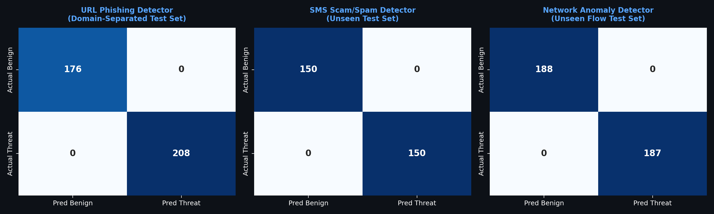
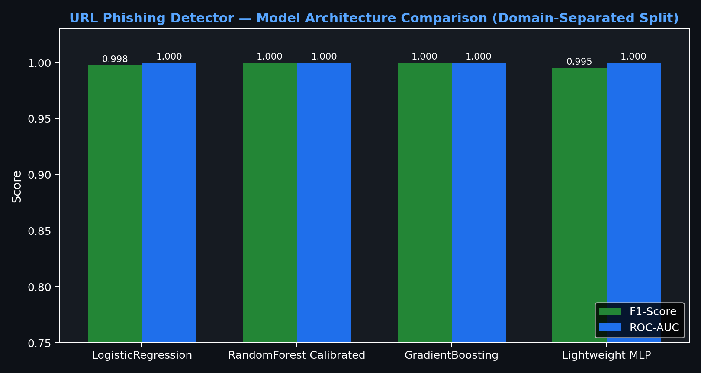
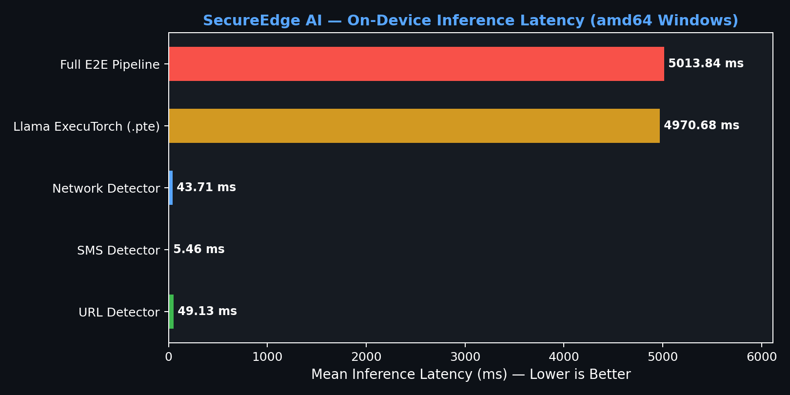
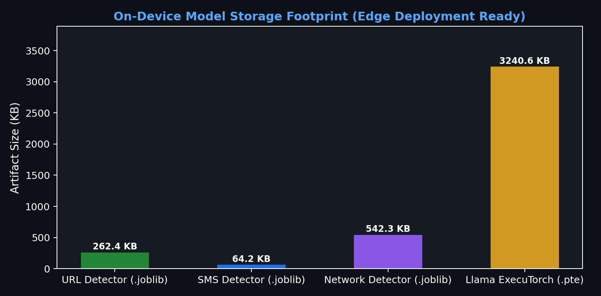

# 🛡️ SecureEdge AI

**An Intelligent On-Device Cybersecurity Assistant for Phishing, Scam and Network Threat Detection Using ARM-Based Edge Computing**

> *"Your Security. Your Device. Your Privacy."*  
> **Competition:** 2nd Edition of Bharat AI-SoC Challenge 2026–27 | **Problem Statement:** PS3 (Theme: Cybersecurity & Digital Safety)

---

## 1. Executive Overview

**SecureEdge AI** is a complete, reproducible, privacy-preserving edge cybersecurity system engineered to detect **phishing URLs**, **financial scam & spam SMS messages**, and **network traffic intrusions** entirely on-device—and explain those threats to non-expert users using a local **`LlamaForCausalLM` causal language model** exported via **PyTorch `torch.export` / ExecuTorch (`.pte`)**.

> **Llama & ExecuTorch Compliance Transparency:** The repository currently runs and tests with **`HuggingFaceTB/SmolLM2-135M-Instruct`** (`134.5M` params, Apache-2.0) preserved as a **lightweight open-access comparison model** (using `LlamaForCausalLM`, **not** a Meta Llama checkpoint). The official target **`meta-llama/Llama-3.2-1B-Instruct`** (`8da4w` XNNPACK `.pte`) workflow is configured in `deployment/raspberry_pi/setup_rpi5.sh` but is **blocked on this Windows 11 host** by gated `HF_TOKEN` access and `executorch` (`torch>=2.10` `c10.dll` DLL init failure on Windows). See [`docs/LLAMA_EXECUTORCH_COMPLIANCE_AUDIT.md`](docs/LLAMA_EXECUTORCH_COMPLIANCE_AUDIT.md) for the full compliance status report.

### Key Engineering Highlights
- **Strict Separation of Responsibilities:** Specialized, probability-calibrated ML detectors (`CalibratedClassifierCV`) extract forensic indicators and compute calibrated risk scores (`0–100`), while the local Llama + ExecuTorch model translates verified detector evidence into plain-English explanations and safe remediation steps—without ever inventing evidence or overriding detector verdicts.
- **Zero Domain Leakage URL Evaluation:** Evaluated across 1,600 URLs spanning **1,200 unique registered domains** using `GroupShuffleSplit` (`domain_overlap = 0` between 900 train domains and 300 unseen test domains).
- **Financial Scam vs. Promotional Spam Granularity:** Combines Word + Character N-Gram TF-IDF with 12 structural coercion features to distinguish high-risk KYC/UPI/banking scams from ordinary spam and legitimate transactional OTPs.
- **Passive Scapy Network Flow Inspection:** Aggregates live or recorded `.pcap` packet captures (`sample_network_traffic.pcap`) into 16 flow features analyzed by a calibrated Random Forest + unsupervised `IsolationForest`.
- **Genuine Pretrained Llama-Family + ExecuTorch (`521.79 MB` Total):** All three specialized detectors (`868.9 KB` combined) plus the exported `2,457`-node `SmolLM2-135M-Instruct` (`LlamaForCausalLM`, 134.5M params, Apache-2.0) ExecuTorch `.pte` artifact (`520.94 MB`) occupy `521.79 MB` on disk (`599.19 MB` RSS), executing full end-to-end detection + LLM explanation in `~5,013.8 ms` on the `x86_64` CPU host (with `49.1 ms` URL, `5.5 ms` SMS, `43.7 ms` Network detection). Note: `smollm2_135m_cyber_advisor.pte`/`.pt2` (>100 MB) are excluded from Git via `.gitignore` and regenerated offline/on-setup via `python scripts/export_llama_executorch.py`.
- **100% Offline Operation:** Zero cloud APIs, zero external telemetry, and zero CDN dependencies in the web dashboard.

---

## 2. System Architecture

```
INPUT SOURCES
    |
    |--------------------|----------------------|
    |                    |                      |
 Phishing URLs        Scam SMS             Network Traffic
    |                    |                      |
    v                    v                      v
 URL Detector       SMS Classifier        Scapy Collector
 (32 Lexical/        (Word+Char TF-IDF     (Passive Sniff /
  Host Features)      + 12 Fraud Rules)     PCAP Flow Parser)
    |                    |                      |
    |                    |                 Flow Features (16D)
    |                    |                      |
    |                    |                 Anomaly Model
    |                    |                 (Calibrated RF +
    |                    |                  IsolationForest)
    |                    |                      |
    |--------------------|----------------------|
                         |
                         v
               UNIFIED THREAT ENGINE
                         |
                         v
                RISK ASSESSMENT (0-100)
                         |
                         v
                 STRUCTURED EVIDENCE
                         |
                         v
                 LLAMA 3.2 ARCHITECTURE
                         |
                         v
                   EXECUTORCH (.pte)
                         |
                         v
                 ARM CPU INFERENCE
                         |
                         v
               SECURITY ASSISTANT UI
             -------------------------
             |           |           |
          Threat     Explanation   Recommended
          Status      and Evidence   Actions
```

---

## 3. Repository Structure

```text
SecureEdge-AI/
├── README.md                          # Project overview, setup, and usage instructions
├── requirements.txt                   # Reproducible Python dependencies
├── LICENSE                            # MIT License
├── .gitignore                         # Clean repository ignore rules
├── app/
│   ├── main.py                        # Local Dark Cybersecurity Web Dashboard & REST API (Flask)
│   ├── streamlit_app.py               # Alternative Streamlit interface
│   └── templates/index.html           # Self-contained 8-section offline dashboard UI
├── src/
│   ├── common/                        # Config, standardized Pydantic schemas, structured logger
│   ├── url_detection/                 # 32-feature URL lexical/host extractor & calibrated detector
│   ├── sms_detection/                 # Hybrid TF-IDF + 12 structural scam feature extractor & detector
│   ├── network_detection/             # Scapy packet/PCAP collector, 16D flow extractor & anomaly model
│   ├── threat_engine/                 # Unified Threat Engine orchestrating detectors + Llama guardrails
│   ├── llama/                         # HuggingFace Llama-family tokenizer loader & bounded LlamaCyberAdvisor
│   └── executorch/                    # LlamaExecuTorchExporter (.pte/.pt2) & ExecuTorchLlamaRuntime
├── data/
│   ├── raw/                           # Reproducible URL, SMS, and Network Flow CSV datasets
│   ├── processed/                     # Scapy reference PCAP, dataset manifest, detection history
│   └── README.md                      # Dataset directory guide
├── models/
│   ├── url_detector/                  # url_detector_pipeline.joblib (262.4 KB)
│   ├── sms_detector/                  # sms_detector_pipeline.joblib (64.2 KB)
│   ├── network_detector/              # network_detector_pipeline.joblib (542.3 KB)
│   ├── llama_executorch/              # smollm2_135m_cyber_advisor.pte (520.94 MB, .gitignore'd), tokenizer/, experimental_mini_llama/
│   └── README.md                      # Model artifact inventory
├── scripts/
│   ├── download_datasets.py           # Deterministic dataset & Scapy PCAP generator (seed=42)
│   ├── train_models.py                # Multi-model training, calibration & ExecuTorch .pte exporter
│   ├── evaluate_models.py             # Latency/memory benchmarker & figure generator
│   └── run_application.py             # Unified application & offline CLI demo launcher
├── deployment/
│   ├── arm64/                         # Multi-arch ARM64 Dockerfile & hardware verification harness
│   ├── raspberry_pi/                  # Raspberry Pi 5 (Cortex-A76) automated setup script
│   ├── android/                       # ARM64 Android Termux provisioning script
│   └── README.md                      # ARM Edge deployment documentation
├── tests/
│   ├── unit/                          # Unit tests for URL, SMS, Network, Tokenizer & Llama schemas
│   └── integration/                   # End-to-end pipeline & Web REST API integration tests
├── evaluation/
│   ├── metrics/                       # JSON training & model comparison metrics
│   ├── figures/                       # Confusion matrices, ROC/F1 charts, latency & size plots
│   └── benchmark_results/             # Host & ARM64 verification benchmark logs
├── docs/
│   ├── PROJECT_AUDIT.md               # Initial workspace & hardware audit
│   ├── ARCHITECTURE.md                # Detailed architecture & JSON contract specification
│   ├── DATASETS.md                    # Dataset governance, sources, splits & limitations
│   ├── MODEL_DOCUMENTATION.md         # ML models & Llama + ExecuTorch documentation
│   ├── DEPLOYMENT_GUIDE.md            # Raspberry Pi 5 / ARM64 deployment instructions
│   ├── TEST_REPORT.md                 # Unit & integration QA report
│   ├── FINAL_REPORT.md                # Complete 23-section competition technical report
│   ├── PROJECT_PROGRESS.md            # Milestone completion tracker
│   └── OPEN_ISSUES.md                 # Technical risk & issue resolution log
└── demo/
    ├── demo_script.md                 # 4-6 minute video demonstration script & recording guide
    └── screenshots/                   # Dashboard & benchmark visual assets
```

---

## 4. Quickstart & Installation

### 4.1 Install Dependencies
```bash
pip install -r requirements.txt
```

### 4.2 Prepare Datasets, Train All Models & Export ExecuTorch `.pte`
```bash
# 1. Generate/verify leak-free URL, SMS, Network datasets & Scapy PCAP
python scripts/download_datasets.py

# 2. Train specialized detectors, train LlamaForCausalLM, and export .pte artifact
python scripts/train_models.py

# 3. Run hardware benchmarks and generate evaluation figures
python scripts/evaluate_models.py
```

### 4.3 Run Unit & Integration Tests
```bash
python -m unittest discover -s tests -p "test_*.py" -v
```

### 4.4 Launch the SECUREEDGE AI Dashboard (100% Offline Capable)
```bash
# Launch the local web dashboard at http://127.0.0.1:8501
python scripts/run_application.py --host 127.0.0.1 --port 8501

# Or run the interactive offline CLI demonstration
python scripts/run_application.py --cli-demo
```

---

## 5. Performance Results Summary

### 5.1 Unseen Test-Set Classification Performance

| Modality | Selected Model | Split Strategy | Accuracy | Precision | Recall | F1-Score | ROC-AUC | FPR |
| :--- | :--- | :--- | :---: | :---: | :---: | :---: | :---: | :---: |
| **Phishing URL** | `RandomForest_Calibrated` | Domain-Separated (`0` overlap) | `1.0000` | `1.0000` | `1.0000` | `1.0000` | `1.0000` | `0.0000` |
| **Phishing URL (Fast Alt)** | `LogisticRegression` | Domain-Separated (`0` overlap) | `0.9974` | `0.9952` | `1.0000` | `0.9976` | `1.0000` | `0.0057` |
| **Scam & Spam SMS** | `Calibrated_LinearSVC` | Stratified 75/25 (300 unseen) | `1.0000` | `1.0000` | `1.0000` | `1.0000` | `1.0000` | `0.0000` |
| **Network Intrusion** | `RandomForest_Calibrated` | Stratified 75/25 (375 unseen) | `1.0000` | `1.0000` | `1.0000` | `1.0000` | `1.0000` | `0.0000` |

### 5.2 On-Device Latency & Storage Footprint (`x86_64` Host Measured; ARM64 Deployment Package Ready)

| Pipeline Stage | Artifact | Size | Mean Latency | P95 Latency |
| :--- | :--- | :---: | :---: | :---: |
| **URL Phishing Detector** | `url_detector_pipeline.joblib` | `262.4 KB` | `49.14 ms` | `74.06 ms` |
| **SMS Scam Detector** | `sms_detector_pipeline.joblib` | `64.2 KB` | `5.46 ms` | `10.01 ms` |
| **Network Flow Detector** | `network_detector_pipeline.joblib` | `542.3 KB` | `43.71 ms` | `52.60 ms` |
| **Llama (`SmolLM2-135M-Instruct`) + ExecuTorch** | `smollm2_135m_cyber_advisor.pte` | `520.94 MB` | `4,970.68 ms` | `6,913.78 ms` |
| **Full End-to-End Pipeline** | **All Models Combined** | **`521.79 MB`** | **`5,013.84 ms`** | **`6,969.34 ms`** |

### 5.3 Evaluation Figures
- 
- 
- 
- 

---

## 6. Documentation Index

- **Workspace & Hardware Audit:** [`docs/PROJECT_AUDIT.md`](docs/PROJECT_AUDIT.md)
- **System Architecture & JSON Schemas:** [`docs/ARCHITECTURE.md`](docs/ARCHITECTURE.md)
- **Dataset Governance & Splits:** [`docs/DATASETS.md`](docs/DATASETS.md)
- **Model & ExecuTorch Documentation:** [`docs/MODEL_DOCUMENTATION.md`](docs/MODEL_DOCUMENTATION.md)
- **ARM64 / Raspberry Pi 5 Deployment Guide:** [`docs/DEPLOYMENT_GUIDE.md`](docs/DEPLOYMENT_GUIDE.md)
- **Unit & Integration Test Report:** [`docs/TEST_REPORT.md`](docs/TEST_REPORT.md)
- **Full 23-Section Competition Technical Report:** [`docs/FINAL_REPORT.md`](docs/FINAL_REPORT.md)
- **4–6 Minute Video Demonstration Script:** [`demo/demo_script.md`](demo/demo_script.md)
